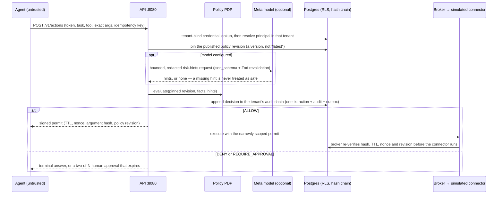
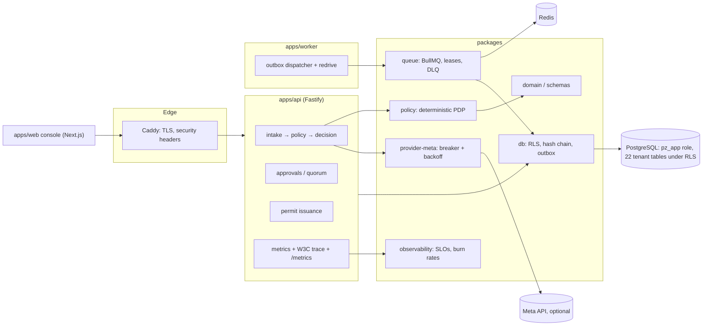

# PermitZero

> **Authority before action.** A zero-trust action firewall that intercepts every consequential tool call made by AI agents, binds it to a tenant, identity, task, policy version and exact argument hash, then allows, denies, queues for human approval, or safely halts the action before a connector can execute it.

PermitZero is a runtime authorization and transaction-control plane for agentic AI, built for the **Meta Global AI Developer Hackathon** (startup track). Finance execution is **simulated** — there are no real bank transfers, custody, private keys, or live payment rails. Performance, compliance, and security claims are **not certified** and require independent validation.

---

## For the judge: sixty seconds, then the evidence

**The one-line bet.** An AI agent with a payment tool should not be able to spend
money because a language model thought it was fine. PermitZero puts a
deterministic, tenant-scoped, tamper-evident authorization plane between the agent
and the connector: the model advises, policy decides, a human can be required, and
every step is written to a hash-chained audit log the database itself enforces.

**Run it.**

```bash
npm ci && cp .env.example .env
npm run db:migrate && npm run db:seed   # synthetic tenant, model provider disabled
npm run dev                             # API :8080, console :3000, worker
npm run demo:scenario                   # allow / deny / approval, end to end
```

**What one decision looks like.**



**How the pieces hold together.**



**Measured, not asserted.**

| Claim                                   | Number                                                                                                                                                                                                                     | Where to check it                                                              |
| --------------------------------------- | -------------------------------------------------------------------------------------------------------------------------------------------------------------------------------------------------------------------------- | ------------------------------------------------------------------------------ |
| Tenant isolation is the database's job  | 22/22 tenant-bearing tables RLS-enabled, forced and policy-covered for a non-exempt role; asserted from the catalog at boot and reported by `/health/ready`                                                                | `infra/migrations/0006_row_level_security.sql`, `packages/db/test/rls.test.ts` |
| The blind escape hatch is read-only     | Migration 0007 narrows `users` and `outbox_events` so a blind transaction can READ them and cannot WRITE them; the column-level rule is a trigger, because a policy cannot express columns                                 | `infra/migrations/0007_rls_write_scope.sql`, `packages/db/test/rls.test.ts`    |
| Decisions are tamper-evident            | Every event hashes the canonical payload plus the previous hash; ten concurrent writers on one tenant finish gapless and the chain verifies                                                                                | `packages/db/test/audit-concurrency.test.ts`, `verifyAuditChain`               |
| A human cannot approve their own action | An approval by the requesting actor is refused at the point of decision, and excluded from the quorum's distinct-approver count                                                                                            | `apps/api/src/approvals.ts`, `apps/api/test/approvals.test.ts`                 |
| Throughput and latency                  | 1,590 requests, 159 fresh policy decisions, server decision p99 **249 ms**, 0 5xx, 0 client failures at 10 concurrent clients                                                                                              | `docs/benchmarks/RESULTS.md`                                                   |
| Where the ceiling actually is           | ~46–63 req/s on one tenant, flat as the runtime pool doubles (2.6%): the per-tenant audit chain is the limit, not the pool                                                                                                 | `docs/benchmarks/SCALING.md`                                                   |
| Objectives that can fail                | Multi-window, multi-burn-rate SLOs with a histogram bucket at the threshold; the report exits non-zero when breached **or when it measured nothing**                                                                       | `packages/observability/src/slos.ts`, `npm run slo:report:strict`              |
| The alerts can actually fire            | Three series that were declared and never written are now produced; the delivery-lag gauge measures the outbox **row**, not the queue job, so a wedged dispatcher cannot read zero                                         | `apps/api/src/observability.ts`, `packages/observability/test/`                |
| Survives a provider or queue outage     | The drill fails the database and the queue mid-flight and asserts no lost events and a bounded shutdown; it does not stop the shared Postgres or claim duplicate delivery                                                  | `npm run drill:resilience`                                                     |
| Nothing unproven is claimed             | 27 controls mapped to code and tests: 16 implemented, 7 partial, **4 absent** (encryption at rest, backup/PITR, retention and deletion, independent review)                                                                | `docs/compliance/EVIDENCE.md`, `npm run compliance:gate`                       |
| Test surface                            | 547 tests across 40 files, plus typecheck, lint at `--max-warnings=0`, format, gitleaks, the dependency gate, the evidence-map gate and a live SLO scrape — all wired into `npm run verify` and `.github/workflows/ci.yml` | `npm run verify`, `.github/workflows/ci.yml`                                   |

**Read the honest parts too.** The model never issues a permit, publishes policy
or calls a connector, and that is structural rather than a convention:
`MODEL_FIELD_IN_ALLOW_RULE` refuses to publish a policy whose ALLOW rules read a
`model.*` field. Finance execution is simulated. The capacity ceiling above is a
consequence of the design, and the remedy (per-tenant chain partitioning) is named
but not built. `npm run compliance:gate` exists so that a control claimed here cannot
quietly rot as the code moves — and it has already caught this repository claiming
things that were not true.

---

## 1. What it does

Companies are connecting AI agents to tools that can read sensitive data and change business state (ERP/AP, vendor master data, payments, refunds, cloud control planes). Existing IAM answers "does this credential have permission to call this API?" — it does not answer "is this exact action, for this task, at this time, within this amount, to this destination, safe and approved?"

PermitZero sits between agent intent and every side-effecting integration and enforces, before dispatch:

- Tenant, identity, agent and tool scope checks
- Deterministic policy evaluation (amount limits, vendor state, PO match, velocity, budget, cooling periods, evidence requirements)
- Risk signals from the Meta Model API (advisory only — never an authorization authority)
- Human approval with separation of duties, bound to the exact action hash and policy revision
- Short-lived, single-use, audience-scoped execution permits
- A broker that is the **only** route to side-effecting connectors, with durable execution-intent records and reconciliation of unknown outcomes
- Append-only, hash-chained audit events from proposal to simulated receipt

---

## 2. Architecture

```
Agent ──POST /v1/actions──► API (Fastify) ──► Intake pipeline
                                    │
                                    ├── authenticate principal, resolve tenant
                                    ├── validate + canonicalize args, hash
                                    ├── pin published policy revision (immutable)
                                    ├── authoritative lookups (vendor, invoice, PO, connector, mode)
                                    ├── derive the effective environment from the credential
                                    ├── Meta Model API screening (advisory; redacted input)
                                    ├── deterministic PDP (policy package)  ← never overridden by model
                                    ├── persist decision + audit event + outbox (one transaction)
                                    ├── issue single-use permit on ALLOW
                                    └── broker executes via simulated connector (permit verified)
                                              │
                                              └── receipt recorded, reconciled, audited
```

### Packages (monorepo workspaces)

| Package                  | Responsibility                                                                                                   |
| ------------------------ | ---------------------------------------------------------------------------------------------------------------- |
| `packages/domain`        | Types, reason codes, errors, canonicalization, money                                                             |
| `packages/schemas`       | Zod request/response + policy + risk-hints (Meta structured output) schemas                                      |
| `packages/policy`        | Pure deterministic PDP: deny precedence, default deny, field resolution, lint, simulation, signed MFA assertions |
| `packages/broker`        | Permit issuing/verification/consumption, broker, simulated finance connector, reconciliation                     |
| `packages/db`            | Drizzle + postgres; migrations, seeds, stores, RLS-friendly tenant scoping                                       |
| `packages/queue`         | BullMQ + transactional outbox, dispatcher, workers, DLQ, Redis circuit breaker                                   |
| `packages/provider-meta` | Meta Model API client: config, prompt, retry, circuit breaker, semaphore, strict validation                      |
| `packages/observability` | Metrics, trace context, SLO definitions, multi-window burn-rate evaluation                                       |
| `packages/ui`            | Shared React UI kit (design tokens, components)                                                                  |
| `packages/test-fixtures` | Synthetic corpus + builders                                                                                      |
| `apps/api`               | Fastify API: intake, approvals, execution, policies, replay, health, status                                      |
| `apps/worker`            | Outbox dispatcher, model-analysis consumer, reconciliation, sweeps, DLQ redrive                                  |
| `apps/web`               | Next.js operator console (dashboard, action queue, policy studio, replay lab, evidence)                          |

### Trust boundaries

- **Agent ↔ API**: agent is untrusted; request fields and content are not trusted.
- **Model provider ↔ backend**: model output is untrusted until schema (Zod) + semantic validation pass.
- **PDP ↔ broker**: narrowly scoped permit is the contract; broker re-verifies hash, TTL, nonce, policy revision.
- **Broker ↔ connector**: only broker holds connector authority; connector credentials never leave the broker.
- **Tenant ↔ tenant**: enforced in the database, not by query discipline. A query that forgets `WHERE tenant_id = ?` returns zero foreign rows rather than all of them.
- **Dashboard user ↔ privileged ops**: authenticated roles, step-up auth for sensitive actions, audit records.

### Delivery

```
push / PR ──► CI: typecheck, lint, 547 tests, build, format, gitleaks,
               dependency gate, evidence-map gate, resilience drill,
               strict SLO report against a live stack
         │
         ├── Dependabot PRs ──► auto-merge once every required check is
         │                      green ON THAT COMMIT
         │
         └── push to main ──► deploy: build, migrate under an advisory lock,
                              health check, verify isolation from the database
```

`main` is protected: three required checks, one approving review, no force
pushes, no deletions, linear history. Auto-promotion is limited to Dependabot's
own dependency bumps — a human-authored change is merged by a human, because
auto-merging one would let a push to a branch bypass review.

---

## 3. Meta Model API usage

Meta's models are used for **structured extraction and advisory risk signals only** (PRD §4.8, §11). Forbidden powers are enforced structurally, not by convention:

- `MODEL_ID` has no default and is never invented (FR-072). Configured value is verified via `discoverModels()`.
- Output is constrained with `response_format: json_schema` (strict) **and** re-validated with Zod `riskHintsSchema` + `validateRiskHintsSemantics()` (evidence refs must be carried, ISO-4217 currency, amount requires currency).
- `lintPolicy()` raises `MODEL_FIELD_IN_ALLOW_RULE` (ERROR) if any `ALLOW` rule references a `model.*` field, so a policy author cannot make the model the final judge.
- A failed/unavailable model never produces hints; `requiredModelSignalUnavailable` makes the PDP yield `REQUIRE_APPROVAL` or `INDETERMINATE` — never `ALLOW`.
- Inputs are redacted/bounded (max 8 untrusted texts × 4,000 chars, 8,000 chars of args); no secrets, signing keys, or unnecessary PII are sent.
- Resilience: retry 429/5xx/network/timeout with `Retry-After` + jittered backoff; never retry 400/401/403/404; circuit breaker (CLOSED→OPEN→HALF_OPEN); FIFO semaphore bulkhead (default concurrency 4).
- `model_evaluations` records metadata only (model id, prompt/schema version, input hash, latency, status, error class) — no raw prompts/outputs.
- The entire demo and all acceptance gates pass with `MODEL_ENABLED=false` (deterministic mode).

See `packages/provider-meta/` and `apps/api/src/model.ts`.

---

## 4. Threat model (summary)

| Threat                           | Mitigation                                                                                                                                                                                                                                                             |
| -------------------------------- | ---------------------------------------------------------------------------------------------------------------------------------------------------------------------------------------------------------------------------------------------------------------------- |
| Agent bypasses PermitZero        | Broker-only credentials; architecture + integration tests; connector access policy                                                                                                                                                                                     |
| Prompt injection in documents    | Untrusted-source labeling; model advisory signal; deterministic scope/amount/destination/approval rules still apply even if detection fails                                                                                                                            |
| False allow from policy bug      | Deny-by-default; replay corpus; mutation tests; two-person policy publication for high-risk rules                                                                                                                                                                      |
| Duplicate payment after timeout  | Durable idempotency; `UNKNOWN_OUTCOME` state; connector reconciliation; no blind retry                                                                                                                                                                                 |
| Stale approval                   | Approval + permit bound to exact hash + policy revision; re-evaluated at execution; an approval by the requester is refused                                                                                                                                            |
| Self-approval                    | The requester is excluded from the approval and from the quorum's distinct-approver count                                                                                                                                                                              |
| Tenant data leak                 | PostgreSQL RLS on the non-exempt `pz_app` role (22/22 tenant tables), a read-only blind escape hatch, transaction-local context that matches zero rows when unset, tenant-id immutability trigger, DDL event trigger for future tables; adversarial cross-tenant tests |
| Model provider outage/rate limit | Model-independent deterministic core; bounded queue; backoff + breaker + safe degraded mode                                                                                                                                                                            |
| Overclaiming compliance/security | Evidence mapping only; independent review; no unsupported certification claims                                                                                                                                                                                         |

---

## 5. Safety boundaries

- **No real money movement.** The connector is simulated; receipts are synthetic. Never point this at a live payment rail.
- **Not certified.** No SOC 2, ISO 27001, PCI DSS, OWASP coverage claims, or legal compliance guarantees. Evidence mapping only.
- **Model is not an authority.** Model output never issues permits, publishes policy, grants approvals, or invokes connectors.
- **No autonomous approval** of material financial actions; quorum + separation of duties enforced.
- **Observe-only / simulation / degraded / emergency-stop** modes are explicitly labeled; the UI shows a persistent banner.
- **Secrets** (model keys, DB URLs, signing keys, connector creds) live in the secret manager/env only; never in browser bundles or logs.

---

## 6. Getting started

### Prerequisites

- Node.js ≥ 20, npm ≥ 10
- PostgreSQL 17 (local or Docker)
- Redis (optional; enables the outbox dispatcher + workers)
- gitleaks (for `npm run secret:scan`)

### Setup

```bash
git clone https://github.com/BROCKUGANDA/permitzero.git
cd permitzero
npm install
cp .env.example .env
# Fill in PERMIT_SIGNING_KEY, AUDIT_HMAC_KEY, DATABASE_URL, etc.
# Meta Model API is OPTIONAL: leave MODEL_PROVIDER=disabled for deterministic mode.
```

### Database

```bash
npm run db:migrate
npm run db:seed            # synthetic demo data (tenant slug: demo)
```

### Run

```bash
npm run dev                # api + worker + web via scripts/dev.mjs
# or individually:
npm run dev:api
npm run dev:worker
npm run dev:web
```

### Demo scenario

```bash
npm run demo:scenario -- --dry-run=false
# or reset everything:
npm run demo:reset
```

### Tests

```bash
npm test                   # vitest (unit + integration)
npm run typecheck
npm run lint
npm run verify             # the release gate, in one command
npm run secret:scan        # gitleaks (working tree)
```

### Model connectivity check

```bash
MODEL_API_KEY=... MODEL_ID=... npm run model:check -w @permitzero/provider-meta
```

---

## 7. Repository layout

```
permitzero/
├── apps/            api, worker, web
├── packages/        domain, schemas, policy, broker, db, queue,
│                    provider-meta, observability, ui, test-fixtures
├── infra/           migrations, docker, deploy, caddy, observability
├── scripts/         dev.mjs, verify.mjs, slo-report.mjs, audit-gate.mjs,
│                    compliance-gate.mjs, resilience-drill.ts
├── docs/            module-contracts.md, compliance/, benchmarks/, incidents.md
├── .github/         workflows (ci, deploy, auto-promote), dependabot.yml
└── README.md
```

---

## 8. Known limitations (hackathon MVP)

- Single-region authoritative writer; no active-active multi-region.
- Simulated connector only; no live payment rails.
- No SSO/SCIM/MFA step-up beyond role-based auth in the MVP. MFA step-up _assertions_ are signed and verified, but there is no step-up endpoint that issues one — so a policy requiring MFA fails closed rather than being satisfied by a typed string.
- Replay Lab replays stored actions; full run-trace replay with redaction is P1.
- Intake throughput is capped by the per-tenant audit hash chain, which serialises
  appends by design: ~46–63 requests/s on one tenant on this rig, flat whether the
  runtime pool is 10 or 25 (`npm run load:sweep`, `docs/benchmarks/SCALING.md`). At
  25 concurrent clients on one tenant, 0.65–0.69% of requests exceeded the client
  timeout, which breaches the 99.9% availability objective — measured, not hidden.
  Per-tenant chain partitioning is the remedy and is not built here.
- No encryption at rest, no backup/PITR procedure, no retention or deletion path,
  and no independent review — all four are recorded as `absent` in
  `docs/compliance/EVIDENCE.md` rather than implied by the word "secure".
- The CI runner is self-hosted on the deploy host, because this account's hosted
  runners are refused with _"your account is locked due to a billing issue."_ That is
  an account billing state and the one thing here that needs a human; clearing it
  and moving back to hosted runners is a one-line change to the `CI_RUNNER`
  repository variable.
- Model confidence is a claim, not a calibrated probability (no labeled eval dataset yet).

---

## 9. References

- OWASP Agentic Applications Top 10 — agentic risk taxonomy (goal hijacking, tool misuse, identity/privilege abuse).
- MAS SAFR (2026) — runtime authorization, human oversight, records of decisions in agentic finance.
- Meta Model API — `https://api.meta.ai/v1` (chat completions, structured output, models, error handling).

---

## License

MIT. See `LICENSE` (add if distributing).
